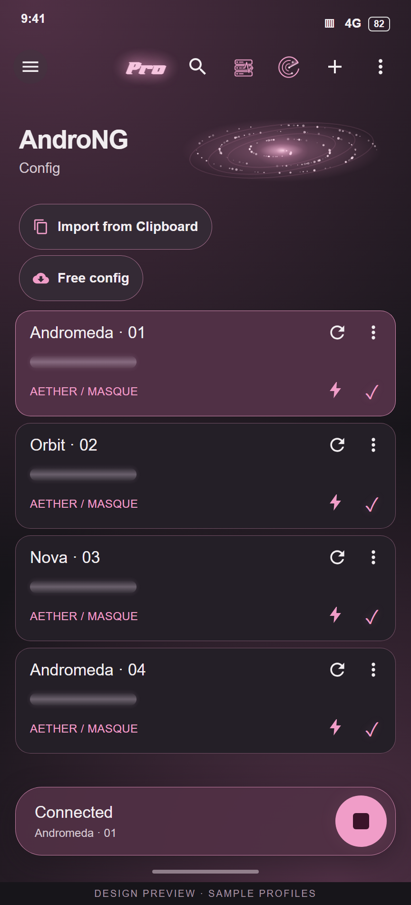

  

  <strong>کمی فضا، یک تجربهٔ اتصال بهتر ✨</strong> 
  A little space. A better connection.

  
  
  

  <a href="#persian">فارسی</a> · <a href="#english">English</a> ·
  <a href="https://github.com/AmirForge/AndroNG/releases/latest">⬇️ Download / دانلود</a> ·
  <a href="https://github.com/AmirForge/AndroNG/releases">🗂️ All releases / همهٔ نسخه‌ها</a>

---

## به دنیای AndroNG خوش آمدی 🌌

با **AndroNG**، کانفیگ‌هایت را مدیریت کن و از طریق آن‌ها به اینترنت متصل شو؛ با ظاهری کهکشانی، رنگ‌های صورتی ملایم و ابزارهایی که کارهای تکراری اتصال را ساده‌تر می‌کنند.

کانفیگت را اضافه کن، اتصال را بزن و بقیهٔ کار را به برنامه بسپار. با پشتیبانی از **Xray و Aether**، می‌توانی کانفیگ‌هایت را در یک جا نگه داری و وضعیت اتصالشان را بررسی کنی.

### چرا AndroNG؟ 💫

- **🌠 یک ظاهر متفاوت:** تم تیره، کهکشان متحرک و جزئیات ستاره‌ای که با وضعیت اتصال همراه می‌شوند.
- **🚀 انتخاب مسیر اتصال:** در Aether، چند اندپوینت می‌توانند برای برقراری اتصال رقابت کنند و گزینهٔ زودتر آماده‌شده انتخاب شود.
- **🔄 نوسازی راحت:** مسیر اتصال کانفیگ Aether را با رفرش به‌روز کن؛ برای آماده‌سازی دوبارهٔ کلید و مسیر اتصال، از صاعقهٔ روی کارت استفاده کن.
- **✅ بررسی کانفیگ‌ها:** اتصال کانفیگ‌ها را بررسی کن و نتیجه را با نشانهٔ واضح ببین.
- **📋 اضافه کردن ساده:** از کلیپ‌بورد، کد QR یا لینک اشتراک استفاده کن؛ لینک‌های **andro://** هم پشتیبانی می‌شوند.
- **🎁 کانفیگ رایگان:** هر وقت در سرویس برنامه موجود باشد، از دکمهٔ **Free config** دریافتش کن.
- **🪐 دسترسی Pro:** اگر اکتیو کد داری، آن را از منوی کناری وارد کن و کانفیگ‌های مربوط به آن را دریافت کن.

### دانلود و نصب ⬇️

**نسخهٔ فعلی: 1.5.0، بیلد 774 — اندروید ۹ به بالا**

- **[دانلود مستقیم APK برای ARM64](https://github.com/AmirForge/AndroNG/releases/download/v1.5.0-774/AndroNG-1.5.0-774-arm64-v8a-release.apk)**
- **[صفحهٔ آخرین نسخه](https://github.com/AmirForge/AndroNG/releases/latest)**
- **[آرشیو تمام ریلیزهای منتشرشده](https://github.com/AmirForge/AndroNG/releases)**

این فایل مخصوص پردازندهٔ **arm64-v8a** است. فایل‌های ZIP و Source code برای نصب روی گوشی نیستند؛ فایل با پسوند **.apk** را دانلود کن.

### اولین اتصال، در سه قدم ✨

1. برنامه را نصب و باز کن.
2. کانفیگت را کپی کن و **Import from Clipboard** را بزن؛ یا در صورت موجود بودن، **Free config** را انتخاب کن.
3. کانفیگ موردنظر را انتخاب کن، دکمهٔ اتصال را بزن و مجوز VPN اندروید را تأیید کن.

اگر یک کانفیگ Aether پاسخ نداد، می‌توانی مسیر اتصالش را رفرش کنی یا کانفیگ دیگری را امتحان کنی. کیفیت اتصال به شبکه و کانفیگی که استفاده می‌کنی هم بستگی دارد.

### همراه ما باش 💌

**[📣 کانال تلگرام](https://t.me/v2meda)** · **[💬 ارتباط با پشتیبانی](https://t.me/v2meda_admin)** · **[⚡ دریافت Pro Code](https://t.me/v2medaCharge_bot)**

---

## A glimpse of AndroNG / نگاهی به طراحی 🪐

  

پیش‌نمایش طراحی با اطلاعات نمونه · Design preview with sample data

---

## Welcome to AndroNG 🌌

**AndroNG** is an Android app for managing your connection profiles, with a cosmic dark interface, soft pink accents, and tools that make everyday connection tasks easier.

Import a profile, tap connect, and keep your configurations together with support for **Xray and Aether**.

### Made for everyday use 💫

- **🌠 A space-inspired interface:** an animated galaxy and star details that respond to connection activity.
- **🚀 Aether endpoint selection:** race multiple endpoints and keep the connection that becomes ready first.
- **🔄 Easy refresh:** renew an Aether profile's endpoints with refresh, or use its lightning action to prepare fresh WARP keys and endpoints.
- **✅ Connection checks:** test your profiles and see a clear connection result.
- **📋 Simple imports:** add profiles from the clipboard, QR codes, subscription links, or **andro://** links.
- **🎁 Free configurations:** use **Free config** whenever profiles are available from the app's service.
- **🪐 Pro access:** enter an activation code from the side menu to retrieve its managed profiles.

### Get the app ⬇️

**Current release: 1.5.0, build 774 — Android 9 and newer**

- **[Download the ARM64 APK](https://github.com/AmirForge/AndroNG/releases/download/v1.5.0-774/AndroNG-1.5.0-774-arm64-v8a-release.apk)**
- **[Latest release](https://github.com/AmirForge/AndroNG/releases/latest)**
- **[All published releases](https://github.com/AmirForge/AndroNG/releases)**

This APK supports **arm64-v8a** devices. To install the app, download the **.apk** file; ZIP files and source archives are for developers.

### Your first connection ✨

1. Install and open AndroNG.
2. Copy your configuration and tap **Import from Clipboard**, or choose **Free config** if profiles are available.
3. Select a profile, tap connect, and approve Android's VPN permission request.

If an Aether profile does not respond, try refreshing its endpoints or selecting another profile. Connection quality also depends on your network and configuration.

### Stay in touch 💌

**[📣 Telegram channel](https://t.me/v2meda)** · **[💬 Support](https://t.me/v2meda_admin)** · **[⚡ Get a Pro Code](https://t.me/v2medaCharge_bot)**

---

  Built on the work of <strong>2dust, patterniha &amp; CluvexStudio</strong> 💗 
  Based on v2rayNG and PattNG; not an official release of either project. 
  <a href="LICENSE">License</a> · <a href="docs/BUILD.md">Build from source</a> · <a href="docs/native-sources.md">Native source information</a>

